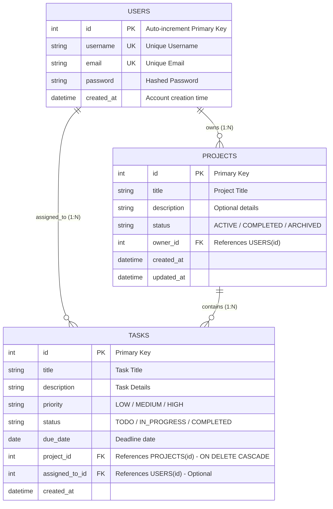

# 🗄️ 02. ER Diagram & Database Structure Design

## ১. ভিজ্যুয়াল ER Diagram (Entity-Relationship Diagram)

নিচে আমাদের ব্যাকএন্ডের রিলেশনাল স্ট্রাকচারটি আঁকা হলো:

---

## ২. রিলেশনশিপ বিশ্লেষণ (Relationships Explained):

1. **User ➔ Project (One-to-Many / 1:N):**
   * একজন ইউজার অনেকগুলো প্রজেক্টের মালিক হতে পারে।
   * কিন্তু একটি নির্দিষ্ট প্রজেক্টের মালিক হবেন একজন ইউজার (`owner_id`)।
2. **Project ➔ Task (One-to-Many / 1:N):**
   * একটি প্রজেক্টের ভেতরে একাধিক টাস্ক থাকবে।
   * প্রজেক্ট ডিলিট হলে টাস্কগুলো স্বয়ংক্রিয়ভাবে মুছে যাবে (`onDelete: Cascade`)।
3. **User ➔ Task (One-to-Many / 1:N - Assigned):**
   * একটি টাস্ক কোনো নির্দিষ্ট ইউজারের ওপর অর্পণ (Assign) করা থাকতে পারে (`assigned_to_id`)।

---

## ৩. ডেটাবেজ নরমালাইজেশন (Database Normalization - 3NF):
* **1NF (First Normal Form):** প্রতিটি কলামে অ্যাটমিক (একটি মাত্র) ভ্যালু থাকবে (কোনো কলামে কমা দিয়ে একাধিক নাম বা অ্যারে রাখা যাবে না)।
* **2NF (Second Normal Form):** সব নন-কী অ্যাট্রিবিউট সম্পূর্ণভাবে প্রাইমারি কী-র ওপর নির্ভরশীল।
* **3NF (Third Normal Form - No Transitive Dependency):** 
  * আমরা `Task` টেবিলে প্রজেক্টের নাম (`project_title`) বা ওনারের নাম (`owner_name`) রাখব না!
  * কারণ ওগুলো `project_id` এবং `owner_id` দিয়ে অন্য টেবিল থেকে পাওয়া যায়। এর ফলে **জিরো ডেটা ডুপ্লিকেশন** নিশ্চিত হয়।
